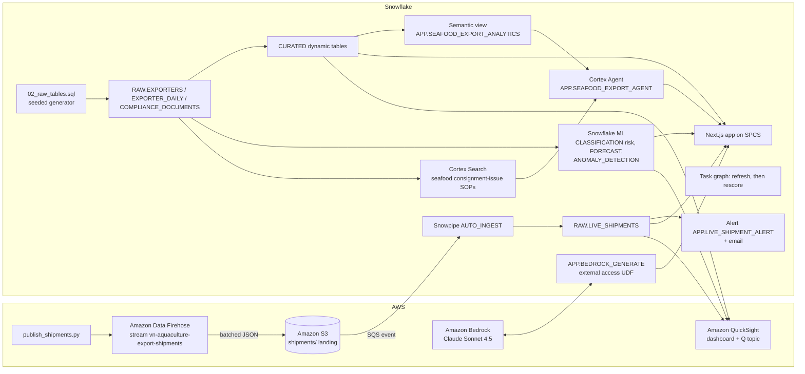

# Vietnam Seafood Export Quality - Import Rejection Risk

Reefer consignment monitoring for **40 fictional Vietnamese seafood exporters**. Each exporter is one fictional processing plant in one of five real Vietnamese cities used as regions (Ca Mau, Can Tho, Long Xuyen, Nha Trang, Ho Chi Minh City), shipping one product line: whiteleg shrimp, black tiger shrimp, pangasius fillet, frozen squid or canned tuna. Snowflake, optionally with AWS, takes the seafood export quality team from a live consignment issue to a 7-day import rejection risk score per exporter, an alert email and an AI action memo.

## Architecture

The pipeline runs on **Snowflake** (Dynamic Tables, Snowflake ML, Cortex Search, Cortex Agent, Cortex AI_COMPLETE, SPCS) and, in the full build, also uses **AWS** (Amazon Data Firehose, S3, Bedrock Claude, QuickSight + Amazon Q). Reefer shipment events arrive in `RAW.LIVE_SHIPMENTS`. Dynamic tables roll 90 days of exporter-day rows into consignments dispatched, export value in USD, consignment issues, import rejections, late arrivals, clean consignment rate and residue lab test compliance. Snowflake ML predicts which exporters are likely to have an import rejection in the next 7 days, forecasts consignment issues across all exporters and flags unusual export document discrepancy rates. A Cortex Agent answers with SQL and SOP citations, and an LLM drafts the action memo for the Head of Seafood Export Quality.

Interactive diagrams (hover for object names): [Snowflake only](docs/architecture-snowflake.html) | [AWS + Snowflake](docs/architecture-aws.html). The app's Architecture & Data tab shows both, the current build first. Regenerate them with `python3 docs/build_architecture.py aws snowflake`.



In the Snowflake-only build there is no AWS subgraph: `APP.SIMULATE_SHIPMENTS` writes to `RAW.LIVE_SHIPMENTS`, and the app calls Cortex `AI_COMPLETE` in place of the Bedrock UDF.

## Snowflake Capabilities

| Capability | Implementation |
|-----------|---------------|
| Dynamic Tables | `CURATED.KPI_SUMMARY`, `PERFORMANCE_SUMMARY`, `ISSUE_SUMMARY`, `TREND_ANALYSIS`, built from the RAW tables |
| Snowflake ML | CLASSIFICATION of 7-day import rejection risk (`ML.REJECT_RISK_SCORES`), a 14-day consignment-issue FORECAST, and export document discrepancy rate ANOMALY_DETECTION |
| Cortex Search | 13 synthetic consignment-issue SOPs (one per product line and issue type with an import rejection) in `SEARCH.ISSUE_SOP_SEARCH` |
| Semantic View | `APP.SEAFOOD_EXPORT_ANALYTICS` over exporters, issue types, daily totals and risk |
| Cortex Agent | `APP.SEAFOOD_EXPORT_AGENT`: Cortex Analyst over the semantic view, plus Cortex Search for SOP citations |
| Cortex AI | `AI_COMPLETE('claude-sonnet-4-5')` for grounded answers, and for the action memo in the Snowflake-only build |
| Alerts + Tasks | `APP.LIVE_SHIPMENT_ALERT` logs ISSUE events and sends email; task graph `TASK_REFRESH_CURATED`, then `TASK_RESCORE_RISK` |
| Snowpark Container Services | Next.js app `APP.VN_AQUACULTURE_EXPORT_APP` with 6 tabs: Executive Cockpit, Predictive, Controls, Live Shipments, Ask AI, Architecture & Data |
| Snowpipe | `RAW.LIVE_SHIPMENTS_PIPE` AUTO_INGEST from S3 (AWS build only) |

## AWS Services

These run only in the AWS + Snowflake build.

| Service | Role in Demo |
|---------|-------------|
| Amazon Data Firehose | Direct PUT stream `vn-aquaculture-export-shipments` takes simulated reefer shipment events and writes them to S3 in batches |
| Amazon S3 | Landing bucket (`shipments/`); an event notification goes to the Snowpipe SQS queue |
| Amazon Bedrock | Claude Sonnet 4.5 drafts the action memo, called from Snowflake through an external-access UDF |
| Amazon QuickSight | DIRECT_QUERY seafood export quality dashboard over Snowflake (daily consignment issues, import rejections by exporter, import rejection risk) |
| Amazon Q | Natural-language questions over the QuickSight topic `vn-aquaculture-export-topic` |
| AWS IAM | Least-privilege roles for S3, Firehose and Bedrock |

## Personas

Both personas are fictional.

| Persona | Role | Key Questions |
|---------|------|---------------|
| **Tran Thi Mai Anh** | Head of Seafood Export Quality | "How many reefer consignments clear without an issue?" "Which issue types end in an import rejection most often?" |
| **Le Minh Khoa** | Seafood Export Quality Analyst | "Which processing plants need a quality review before their next sailing, and what does the SOP say to do?" |

## Data

Every table is synthetic and HASH-seeded, so a rebuild reproduces it. The exporters, buyers and all names are fictional; the five cities are real Vietnamese cities used only as regions. No real company, port authority, importing country procedure or regulation is described.

| Table | Rows | Description |
|-------|------|-------------|
| RAW.EXPORTERS | 40 | Seafood exporters in 5 Vietnamese cities and 5 product lines (Whiteleg shrimp, Black tiger shrimp, Pangasius fillet, Frozen squid, Canned tuna), with an operating risk tier |
| RAW.EXPORTER_DAILY | 3,600 | One row per exporter per day for 90 days: consignments, export value (USD), consignment issues, import rejections, late arrivals, issue type, residue lab tests, export document discrepancy rate and certificate turnaround time |
| RAW.COMPLIANCE_DOCUMENTS | 40 | Required, on-file and pending export documents per exporter (health certificates, catch certificates, farm registrations, antibiotic test reports, retort records) |
| SEARCH.ISSUE_DOCS | 13 | Synthetic consignment-issue SOPs indexed for Cortex Search |
| RAW.LIVE_SHIPMENTS | Grows during the demo | Live reefer shipment events from Firehose (AWS build) or `APP.SIMULATE_SHIPMENTS` (Snowflake-only build) |
| ML.REJECT_RISK_SCORES | 40 | 7-day import rejection probability and risk band per exporter |

## Build Instructions

### Prerequisites
- Snowflake account with ACCOUNTADMIN access, and Cortex AI enabled (AI_COMPLETE, Search, Agent).
- An X-Small warehouse with auto-suspend at or below 120 s, and an existing SPCS compute pool.
- Python 3.11+, `snowflake-connector-python`, Node.js 22+, Docker and the `snow` CLI.
- App image: run `snow spcs image-registry login`, then build and push `vn-aquaculture-export-app:v1` to the database's `APP.IMAGES` repository (see the header of `snowflake/07_deploy_app.sql`).
- AWS build only: `boto3`, AWS credentials for the target account (us-west-2) with Bedrock access, and QuickSight Enterprise.

### SPCS App
```
<DATABASE>.APP.VN_AQUACULTURE_EXPORT_APP
```

### Tests
```bash
python -m pytest aws snowflake quicksight
```

For a local run, put `SNOWFLAKE_ACCOUNT`, `SNOWFLAKE_USER`, `SNOWFLAKE_DATABASE`, `SNOWFLAKE_WAREHOUSE`, `SNOWFLAKE_AUTHENTICATOR=PROGRAMMATIC_ACCESS_TOKEN`, `SNOWFLAKE_TOKEN` and `DEMO_PLATFORM` in the environment, then run `npm --prefix app run build && npm --prefix app start`.

## Build Modes

The two modes run on one shared core and differ in three layers. The `DEMO_PLATFORM` value in the app SPCS spec selects the memo provider and the Live Shipments copy.

| Layer | Snowflake Only | Full AWS + Snowflake |
|---|---|---|
| Live shipments | `CALL APP.SIMULATE_SHIPMENTS(n)` inserts simulated reefer shipment events into `RAW.LIVE_SHIPMENTS`. This simulates a shipment feed; it is not Snowpipe Streaming | `aws/publish_shipments.py` to Amazon Data Firehose, then S3, SQS and Snowpipe AUTO_INGEST |
| Action memo | Cortex `AI_COMPLETE('claude-sonnet-4-5')` | Amazon Bedrock Claude Sonnet 4.5 through `APP.BEDROCK_GENERATE` |
| BI and natural-language questions | The SPCS app is the dashboard; questions go to the Cortex Agent | Also a QuickSight dashboard and an Amazon Q topic |
| App setting | `DEMO_PLATFORM: snowflake` | `DEMO_PLATFORM: aws` |

### Snowflake Only

```bash
# 1. Core data and dynamic tables (guarded: new isolated database only)
python snowflake/run_core.py --database VIETNAM_AQUACULTURE_EXPORT_SNOWFLAKE --warehouse <XS_WAREHOUSE> --connection <CONNECTION> --apply
# 2. Native shipment feed, ML, search, semantic view, agent, alert and task graph
python snowflake/run_intelligence.py --database VIETNAM_AQUACULTURE_EXPORT_SNOWFLAKE --platform snowflake --warehouse <XS_WAREHOUSE> --connection <CONNECTION> --alert-email you@example.com
# 3. App on SPCS with DEMO_PLATFORM=snowflake (push the image first)
python snowflake/run_intelligence.py --database VIETNAM_AQUACULTURE_EXPORT_SNOWFLAKE --platform snowflake --warehouse <XS_WAREHOUSE> --connection <CONNECTION> --alert-email you@example.com --files 07_deploy_app.sql --compute-pool <COMPUTE_POOL>
```

During the demo:
- Run `CALL APP.SIMULATE_SHIPMENTS(20)` to add live reefer shipment events. For a continuous feed, run `ALTER TASK APP.TASK_SIMULATE_SHIPMENTS RESUME`, and `SUSPEND` it afterwards.
- Run `EXECUTE ALERT APP.LIVE_SHIPMENT_ALERT` to raise the alert email.
- Run `EXECUTE TASK APP.TASK_REFRESH_CURATED` to refresh the curated tables and rescore import rejection risk.

Afterwards, drop the database or run `ALTER SERVICE APP.VN_AQUACULTURE_EXPORT_APP SUSPEND`.

### Full AWS + Snowflake

```bash
# 1. Core data and dynamic tables (guarded: new isolated database only)
python snowflake/run_core.py --database VIETNAM_AQUACULTURE_EXPORT_AWS --warehouse <XS_WAREHOUSE> --connection <CONNECTION> --apply
# 2. AWS ingestion and Bedrock (dry run first, then --apply)
python aws/setup_aws.py --database VIETNAM_AQUACULTURE_EXPORT_AWS --account <AWS_ACCOUNT_ID> --connection <CONNECTION> --apply
# 3. ML, search, semantic view, agent, alert and task graph
python snowflake/run_intelligence.py --database VIETNAM_AQUACULTURE_EXPORT_AWS --platform aws --warehouse <XS_WAREHOUSE> --connection <CONNECTION> --alert-email you@example.com
# 4. App on SPCS with DEMO_PLATFORM=aws (push the image first)
python snowflake/run_intelligence.py --database VIETNAM_AQUACULTURE_EXPORT_AWS --platform aws --warehouse <XS_WAREHOUSE> --connection <CONNECTION> --alert-email you@example.com --files 07_deploy_app.sql --compute-pool <COMPUTE_POOL>
# 5. QuickSight dashboard and Q topic (needs an existing Snowflake data source)
python quicksight/build_dashboards.py --database VIETNAM_AQUACULTURE_EXPORT_AWS --account <AWS_ACCOUNT_ID> --principal-arn <QUICKSIGHT_USER_ARN> --data-source-arn <DATA_SOURCE_ARN> --prefix vn-aquaculture-export --apply --update --with-topic
```

QuickSight objects must be shared with the QuickSight user who signs in (`--principal-arn`); otherwise the console shows nothing.

During the demo:
- Run `python aws/publish_shipments.py --count 20` to send live reefer shipment events. Firehose buffers for up to 60 seconds before writing to S3.
- Run `EXECUTE ALERT APP.LIVE_SHIPMENT_ALERT` to raise the alert email.
- Run `EXECUTE TASK APP.TASK_REFRESH_CURATED` to refresh the curated tables and rescore import rejection risk.


When you are done, `python aws/teardown_aws.py --database VIETNAM_AQUACULTURE_EXPORT_AWS --account <AWS_ACCOUNT_ID> --connection <CONNECTION> --apply` deletes the AWS resources plus the account-level Bedrock external-access and S3 storage integrations. The email integration `VN_AQUACULTURE_EXPORT_EMAIL_INT` stays, because the Snowflake-only build uses it too.

## Business Impact

Industry research and a Snowflake customer outcome:
- **Aquaculture now leads aquatic animal production**: "In 2022 and for the first time in history, aquaculture surpassed capture fisheries as the main producer of aquatic animals." -- [FAO, The State of World Fisheries and Aquaculture 2024 news release](https://www.fao.org/newsroom/detail/fao-report-global-fisheries-and-aquaculture-production-reaches-a-new-record-high/en)
- **Viet Nam is a top seafood exporter in a large trade**: "Top exporters of aquatic animal products: China, Norway, Viet Nam, Ecuador, Chile" and "Value of international trade of aquatic products: USD 195 billion" -- [FAO, The State of World Fisheries and Aquaculture 2024 news release](https://www.fao.org/newsroom/detail/fao-report-global-fisheries-and-aquaculture-production-reaches-a-new-record-high/en)
- **Ryder** (Snowflake customer, supply chain): "With Snowflake, Ryder’s unplanned data outages occur 33% less often, and latency events have essentially dropped to zero." -- [Snowflake customer story: Ryder](https://www.snowflake.com/en/customers/all-customers/case-study/ryder/)

## Key Demo Numbers

All figures are synthetic and come from the seeded demo data. Forecast and anomaly figures can shift slightly with the build day.

- **40 seafood exporters** in 5 Vietnamese cities and 5 product lines, 3,600 exporter-days over 90 days: **16,282 consignments** worth USD 2.76 B
- **Clean consignment rate 96.03%**: **647 consignment issues**, of which **218** ended as import rejections (issue rejection rate 33.7%), and **94 late arrivals**
- **Health certificate mismatch** causes the most import rejections (82 of 214 issues); the 16 storm port closure issues (Nha Trang and Ca Mau) were all resolved without a rejection
- **Pangasius fillet** plants have the most import rejections (80) and black tiger shrimp the fewest (5); exporters in **Nha Trang** have the most (78) and Ho Chi Minh City the fewest (19)
- **Import rejection model**, out-of-time holdout: precision 0.51 and recall 0.41 at a 0.5 threshold, against a 0.30 base rate. 8 exporters are high risk; the top one, EXP-0011, scores 96.9%
- **14-day consignment-issue forecast** with prediction intervals; **33 of 640** recent exporter-days flagged as document discrepancy rate anomalies
- **Residue lab test compliance 71.4%**; export document coverage 60.6%, with 18 documents pending
- **13 SOPs** indexed in Cortex Search and cited by ID in agent answers

## License

Apache 2.0 — See [LICENSE](LICENSE) for details.

This is a personal demo project and is not an official Snowflake offering. It comes with no support or warranty. Industry metrics cited are from publicly available third-party research and Snowflake customer stories; they represent reported outcomes and are not guarantees of results.
